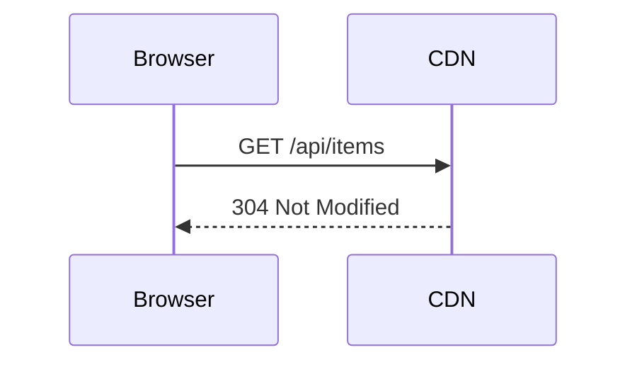

# Cover image and diagrams

> **In this skill, default to running `scripts/make_cover.py` (8C) and viewing the PNG.** Use 8B (HTML) only if the script can't run, and 8D only if the user has just an image generator. The script's flags map one-to-one to the 8A spec; `--author` is `Jaydeep Kanzariya` unless told otherwise.

## PART 8 — Cover image

Always produce **8A (the spec)**. Then run the script (**8C**, the default in this skill). Use **8B** only if the script can't run, and **8D** only if the user says they have just an image generator.

Target size is **1600×840 PNG**. That's the same 1.905:1 ratio as the common 1200×630 Open Graph size and exactly 1.333× its dimensions, so it downscales cleanly for social cards while staying sharp on retina. Hashnode's guidance is a 1.9:1 ratio at 800×420 or larger, with 1600×840 named as a good choice. Hashnode does not accept SVG covers.

### 8A — The spec (always)

- **Cover title** — 4–7 words, *not* the post title. The cover is read at thumbnail size in a feed; a full sentence turns into grey mush. Wrap exactly one phrase in `*asterisks*` for the accent — the API, the number, the verdict. Two highlights means neither is emphasised.
- **Subtitle** — one line, under 12 words.
- **Kicker** — `topic · post type`, e.g. `react · deep dive`.
- **Style** — `codeframe` (a source-file card: filename tab, line-number gutter; versatile default), `terminal` (a shell session: prompt line, tag chips — CLI, DevOps, backend), or `blueprint` (light engineering paper: hairline grid, highlighter swipe — architecture, design systems, comparisons, and it stands out in a feed of dark covers).
- **Accent hex** — pick from the stack's own palette, not a random colour: react `#5CD3EE` · typescript `#4C8DFF` · javascript `#F2C14E` · node `#7FC96A` · python `#4FA3D1` · go `#4FD1D9` · rust `#F0803C` · postgres `#5C9DD8` · mysql `#4FA0B8` · mongodb `#5FC97E` · redis `#E8574A` · graphql `#E858A6` · docker `#4FA8F0` · kubernetes `#5B7CF0` · aws `#F0973C` · azure `#41A5F5` · git `#F0703C` · ai/llm `#B98CFF` · tailwind `#4FC3D9` · nextjs `#E6E9EF`. Anything else: `#6FA8FF`.
- **Footer** — author name and read time.

### 8B — Self-contained HTML (fallback)

Output one complete HTML file the user can open and screenshot at 1600×840. Follow this spec exactly so every cover on their blog matches:

- Body exactly 1600×840, `margin:0`, `overflow:hidden`. Fonts: a geometric sans for display (`Poppins`, `Inter`, system-ui fallback) and a monospace for kicker/footer (`JetBrains Mono`, `SFMono-Regular`, monospace). Load webfonts from a CDN link, and keep the fallback chain so it still renders offline.
- **codeframe**: background `#0B1220` with a soft radial accent glow at 40% opacity in the top-right corner. Inset a card at 46px margin, `border-radius:26px`, fill `#111728` at 90%, `1.5px` border `rgba(255,255,255,.10)`. A 70px header strip holds a filename tab (`post-slug.md`, mono 21px, tab background `#182036`, 3px accent bar along its bottom edge) on the left and my handle in mono 19px `#68768E` on the right. Below it, a 104px-wide gutter of mono 19px line numbers in `#4E5C76` — one per rendered text row. Content: kicker in mono bold 20px, uppercase, 2.4px letter-spacing, accent colour; then the title in display bold, 96px, `line-height:1.16`, colour `#F0F4FA`, wrapped to at most 3 lines, with the `*highlighted*` phrase drawn in the accent colour on a `rgba(accent,.16)` rounded chip; then the subtitle in display light 27px `#8A98B0`, max 2 lines. Footer row: a 12px accent dot, my name in display medium 21px `#B2BED4`, read time right-aligned in mono 19px `#68768E`.
- **terminal**: background `#070A10` with an accent glow bottom-left. A 64px top bar `#101620` with three 14px `#3A4456` dots on the left and the filename centred in mono 20px `#7E8CA4`. Body: a prompt line in mono 24px — `~/posts` in `#60BE96`, `$` in the accent, `cat post-slug.md` in `#96A4BE` — then the title in display bold 88px `#EEF3FA` with a `›` marker in the accent, then the subtitle in display light 26px `#92A0B8`. Bottom: tag chips as pill outlines `1.5px rgba(accent,.42)`, mono 20px, accent text; my name right-aligned in mono 21px `#78869E`.
- **blueprint**: background `#EEF1F4` with two hairline grids — 48px at `rgba(16,24,34,.05)` and 192px at `rgba(16,24,34,.10)` — plus small `+` registration marks inset 44px in each corner. Kicker in mono bold 21px, uppercase, 3px letter-spacing, `#68768A`, with a 72×4px accent rule under it. Title in display bold 92px `#101822`, and the `*highlighted*` phrase sits on a `rgba(accent,.34)` highlighter swipe rotated `-0.7deg` with 6px radius. Subtitle in display light 27px `#68768A`. A hairline rule 104px from the bottom, my name below it left, read time right in mono 19px.
- No stock photos, no decorative gradients beyond the single glow, no emoji, no icon fonts, no drop shadows on text.

Tell the user in one line to screenshot it at 1600×840 (browser devtools device toolbar, or a full-page capture extension).

### 8C — Script command (default)

```bash
python3 make_cover.py \
  --title "Why your *useEffect* runs twice" \
  --subtitle "StrictMode, double invocation, and the bugs it exposes early" \
  --kicker "react · deep dive" \
  --tech react --author "Jaydeep Kanzariya" --meta "8 min read" \
  --style codeframe --out cover.png
```

### 8D — Image-generator fallback (only if the user has no other option)

Do **not** ask an image model to render the title — text in generated images comes out warped and unusable. Instead give the user a prompt for a **textless 1600×840 background**, then tell them to overlay the type themselves in Canva or Figma using the 8A values.

Background prompt template, filled in for the topic:

> Abstract technical background, 1600×840, deep ink `#0B1220`, subtle geometric structure suggesting `<the topic's own visual world — layered planes for caching, branching paths for routing, nested frames for a component tree>`, a single soft light source in the upper right in `<accent hex>`, fine dot grid texture at very low contrast, generous empty space in the left two-thirds for text, no text, no letters, no logos, no people, flat vector style, matte finish.

Then: "Place the cover title in a bold geometric sans at ~90px in the empty left area, the highlighted phrase in `<accent hex>`, kicker above in small uppercase monospace, author and read time along the bottom."

## PART 9 — Diagrams

Suggest a diagram only where one genuinely beats prose: request/data flow, state machines, architecture with 3+ components, sequence and timing, ER relationships, before/after topology. Most posts need zero or one. A post with four diagrams and one idea is padding.

**Output them as Mermaid**, in a fenced ` ```mermaid ` block, ready to paste:



Mermaid renders in Hashnode's Docs product; on blog posts, check the preview first. If it doesn't render, tell the user to export a PNG with `npx @mermaid-js/mermaid-cli -i diagram.mmd -o diagram.png` and reference that file instead.

Keep labels short — Mermaid doesn't wrap gracefully. Do **not** write image-generation prompts for architecture diagrams; image models garble technical labels and the output isn't shippable. Reserve image prompts for conceptual illustrations only, and say plainly when a hand-made diagram would be better.
