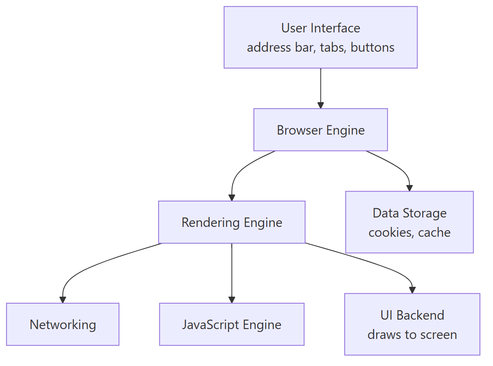
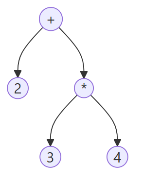
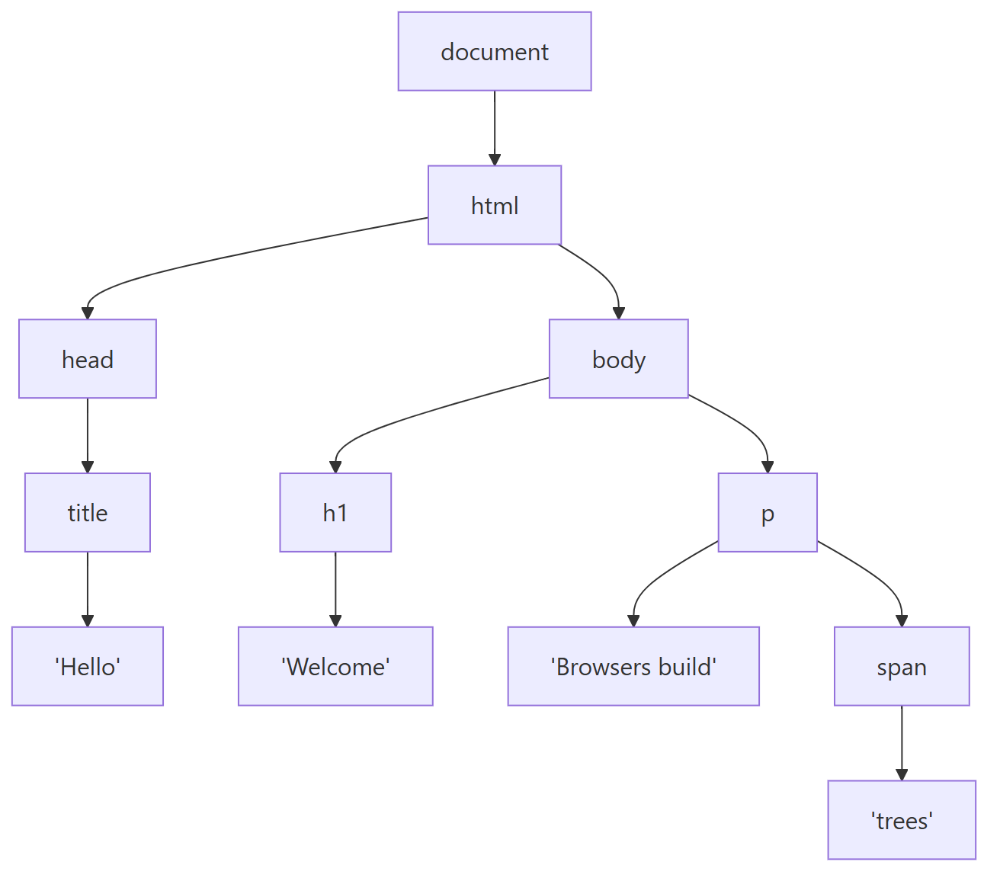
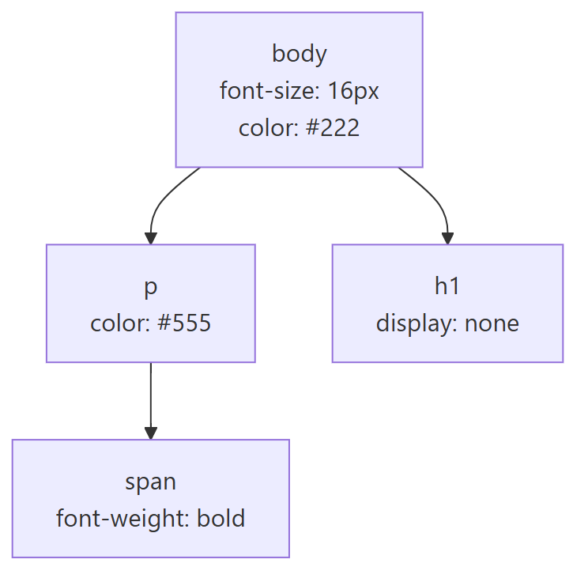
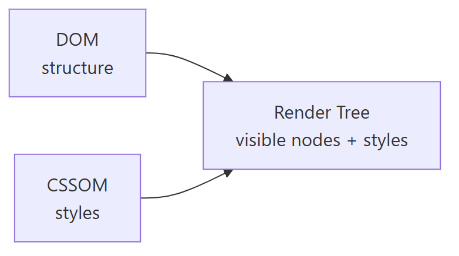
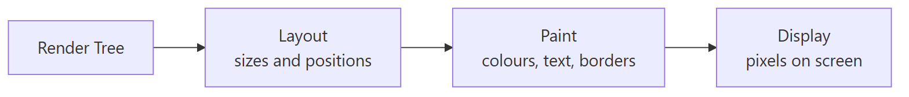
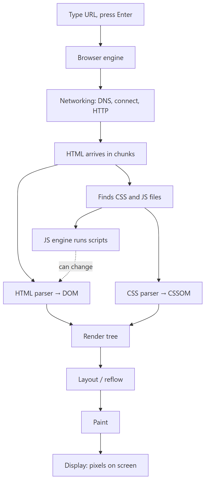

You type `example.com` into the address bar and press Enter. A moment later there's a page. Most beginners carry a simple model of what happened in between: the browser downloads the page, then shows it.

That model is wrong in a useful way. A browser doesn't receive a finished page. It receives **text**: HTML, CSS and JavaScript, as plain characters. It has to read that text, understand it, build structures out of it, work out where every box goes and then colour in pixels. And it starts doing all of that before the download has even finished.

This post walks through how a browser works, one step at a time. You don't need to memorise the names. Follow the flow; the names will stick on their own.

## A browser is a team of parts, not one program

"The browser opens websites" is true the way "a restaurant gives you food" is true. Behind the counter there's a team, and each member has one job.


*The parts of a browser and who talks to whom.*

- **User interface**: everything you click that isn't the page itself. The address bar, tabs, back and forward buttons, the reload button, bookmarks.
- **Browser engine**: the coordinator. It takes your actions in the UI ("go to this URL", "go back") and tells the rendering engine what to do.
- **Rendering engine**: the part that turns HTML and CSS into a page you can see. Most of this post is about this one.
- **Networking**: fetches files over the internet.
- **JavaScript engine**: runs your JS.
- **UI backend and data storage**: draw basic widgets on the screen, and keep cookies, cache and local storage.

### Browser engine vs rendering engine

These two get mixed up constantly, partly because people say "engine" loosely. The simple distinction: the **browser engine** is the manager that connects the UI to everything else; the **rendering engine** is the worker that builds and draws the page.

For names only: Chrome and Edge use the Blink rendering engine, Firefox uses Gecko, Safari uses WebKit. Their JavaScript engines are V8, SpiderMonkey and JavaScriptCore. The details differ between them, but the flow in this post is the same in all of them.

## Step 1: networking fetches the HTML

When you press Enter, the networking part does roughly this:

1. **DNS lookup**: turn `example.com` into an IP address, the server's actual location.
2. **Connect**: open a connection to that server (plus a TLS handshake for `https`, so the connection is encrypted).
3. **HTTP request**: ask for the page with `GET /`.
4. **Response**: the server sends back an HTML file.

The important detail: the HTML arrives in **chunks**, not all at once. The browser doesn't wait for the last chunk. It hands the first bytes to the rendering engine immediately.

And the HTML is only the first file. As the browser reads it, it finds `<link rel="stylesheet">`, `<script src>` and `` tags, and each one becomes another network request. A page is many downloads, discovered while the first one is still being read.

## Step 2: parsing, explained with a math problem

Before we look at HTML, here's the one idea everything else rests on: **parsing**.

Parsing means taking a flat string of characters and turning it into a structure that has meaning. You do it every time you read a sentence. "The cat sat on the mat" is a row of letters, but your brain splits it into words, then works out who did what.

A browser does the same with code. Take this expression:

```text
2 + 3 * 4
```

To a computer, that's nine characters. A parser does two things with it:

1. **Tokenising**: split it into meaningful pieces: `2`, `+`, `3`, `*`, `4`.
2. **Building a tree**: arrange the pieces by their rules. Multiplication binds tighter than addition, so `3 * 4` becomes its own branch.


*The tree decides the order: `3 * 4` is computed first.*

Evaluate the tree from the bottom up: `3 * 4` is 12, then `2 + 12` is 14. You can check it in any browser console:

```js
console.log(2 + 3 * 4);
```

```text
14
```

Not 20. The tree, not the left-to-right order of the characters, decides the meaning. Hold on to that picture: **characters → tokens → tree**. The browser runs this same process on your HTML and CSS.

## Step 3: HTML becomes the DOM

The HTML parser reads the incoming text, splits it into tokens (start tags, end tags, text) and builds a tree of objects called the **DOM**, the Document Object Model.

Here's a small constructed example:

```html
<html>
  <head>
    <title>Hello</title>
  </head>
  <body>
    <h1>Welcome</h1>
    <p>Browsers build <span>trees</span>.</p>
  </body>
</html>
```


*Every tag and every piece of text becomes a node.*

Think of the DOM as a family tree. `html` is the ancestor, `head` and `body` are its children, `h1` and `p` are siblings. Every tag becomes a node, and so does the text inside it.

The DOM is also what JavaScript talks to. When you write `document.querySelector('h1')`, you're not searching your HTML file. You're searching this tree.

## Step 4: CSS becomes the CSSOM

CSS goes through its own parser and becomes a second tree: the **CSSOM**, the CSS Object Model.

```css
body { font-size: 16px; color: #222; }
p    { color: #555; }
span { font-weight: bold; }
h1   { display: none; }
```


*Inherited properties like `color` and `font-size` flow down unless a child overrides them.*

Why a tree and not a list? Because styles **cascade**. The `span` inside the `p` gets `font-weight: bold` from its own rule, `color: #555` from its parent `p`, and `font-size: 16px` from `body`. The browser works out the final, computed style for every element by walking down the tree.

## Step 5: DOM + CSSOM become the render tree

Now the browser has two trees: one saying *what* is on the page, one saying *how it should look*. It combines them into a third: the **render tree**, which contains only the things that will actually appear on screen, each with its final styles.


*Structure plus style, minus anything that won't be shown.*

Two things get left out:

- Elements that never render: `<head>`, `<title>`, `<script>`, `<meta>`.
- Anything with `display: none`. In our example, the `h1` is in the DOM but **not** in the render tree.

A subtle one: `visibility: hidden` elements *are* in the render tree. They're invisible but still take up space, so the browser has to keep them around for the next step.

## Step 6: layout, paint, display

The render tree knows what to show and how it should look. It doesn't yet know *where*. Three more steps turn it into pixels.


*Where, then what colour, then onto the screen.*

**Layout** (Firefox calls it **reflow**) works out the exact size and position of every box. The `p` is this wide because the viewport is that wide; the `span` sits at this x and y position because of the text before it. It's geometry, done for the whole page.

**Paint** fills in the boxes: text, colours, borders, shadows, images. The browser produces a list of drawing instructions, often split into layers.

**Display** (engines call this step compositing) stacks those layers in the right order and puts the final pixels on your screen.

The part that matters later: this isn't a one-time job. If JavaScript changes an element's width, adds a node or the window is resized, the browser has to run layout again for the affected parts, then paint again. Changing only a colour skips layout and goes straight to paint. That difference is the root of most rendering-performance advice you'll read later. You don't need it today, but it explains why the steps are separate.

## Where the simple model breaks

So far it sounds like a neat assembly line: download, DOM, CSSOM, render tree, layout, paint. Real browsers are messier, and three of the messy parts affect the HTML you write.

**The DOM is built as the HTML streams in.** The parser doesn't wait for the full file. That's why a slow page can show its top half while the bottom is still loading.

**CSS blocks rendering.** The browser won't paint until it has the CSSOM for stylesheets in the `<head>`, because painting first and restyling a moment later would make the page flash unstyled content. A slow stylesheet means a blank screen for longer.

**A plain `<script>` pauses the HTML parser.** JavaScript can change the DOM while it's being built, so when the parser meets a classic script tag, it stops, downloads and runs the script, then carries on.

```html
<!-- ❌ Parser stops here until app.js downloads and runs -->
<head>
  <script src="app.js"></script>
</head>
```

```html
<!-- ✅ Downloads in parallel, runs after the HTML is parsed, in order -->
<head>
  <script src="app.js" defer></script>
</head>
```

`defer` isn't always right. If a script has to run before the page appears (some theme or feature-detection scripts do, to avoid a visual flash), deferring it is the wrong call. For most application code, it's the sensible default.

One more thing you can see for yourself: the parser repairs broken HTML. Paste this into any browser console:

```js
const doc = new DOMParser().parseFromString('<p>Hi', 'text/html');
console.log(doc.documentElement.outerHTML);
```

```text
<html><head></head><body><p>Hi</p></body></html>
```

That's the output in Chrome 157; other browsers repair it the same way, because the repair rules are part of the HTML spec. The input had no `<html>`, no `<body>` and an unclosed `<p>`. The DOM has all three. That's why the DevTools Elements panel can differ from "View Source": one shows the tree, the other shows the text the tree was built from.

## The whole trip in one picture


*The whole trip, from Enter to pixels.*

If that looks like a lot, it is. Nobody remembers all of it on day one, and you don't need to. The version worth keeping is short: **text comes in, gets parsed into two trees, the trees merge, the browser measures, then it paints.** Every term in this post hangs off that sentence.

The honest limitation of this model: real engines add steps I've skipped, such as preload scanners that hunt for files ahead of the parser, splitting work across threads, and GPU compositing. Their names for each stage also differ. The flow above is the shared idea, not any single engine's implementation.

If you want to go one level deeper, two sources I'd trust: MDN's [Populating the page: how browsers work](https://developer.mozilla.org/en-US/docs/Web/Performance/Guides/How_browsers_work), which follows the same URL-to-pixels path with more detail on networking, and web.dev's [How browsers work](https://web.dev/articles/howbrowserswork), the long classic that goes inside the parsers.

Open DevTools on a page you built and compare the Elements panel with View Source: did the parser add or move anything you didn't write?
